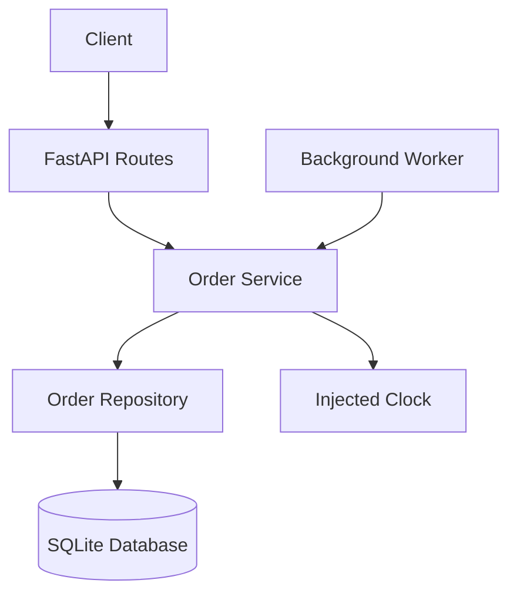

# MiniDash – Scheduled Orders Design

## 1. Architecture Overview

MiniDash will use a layered architecture built with Python, FastAPI, and SQLite.

The application will separate HTTP request handling, business logic, and database access to make the system easier to test and maintain.

### Components

| Component | Responsibility |
|---|---|
| Routes | Receive HTTP requests and return responses |
| Services | Handle order creation, scheduling validation, cancellation, and release logic |
| Repositories | Read and write restaurant and order data |
| Database | Store restaurants, menu items, orders, and order items |
| Clock | Provide the current time through an injectable interface |

## 2. API Interfaces

The application will support these baseline endpoints:

| Method | Endpoint | Purpose |
|---|---|---|
| GET | /restaurants | List restaurants |
| GET | /restaurants/{id}/menu | Retrieve a restaurant menu |
| POST | /orders | Create an immediate or scheduled order |
| GET | /orders/{id} | Retrieve order details |
| PATCH | /orders/{id}/status | Update order status |

The scheduled-order feature will extend the order creation request with an optional `scheduled_for` field.

A cancellation operation will allow customers to cancel orders while they remain in the `SCHEDULED` status.

## 3. Database Changes

### Existing Tables

- restaurants
- menu_items
- orders
- order_items

### Orders Table Changes

Add the following field:

| Field | Type | Description |
|---|---|---|
| scheduled_for | TEXT, nullable | Requested delivery date and time, stored in ISO 8601 format |

The existing `status` field will support these additional values:

- SCHEDULED
- PLACED
- PREPARING
- READY
- DELIVERED
- CANCELLED

### Scheduling Behavior

- Immediate orders follow the existing order workflow.
- Scheduled orders are initially saved with status `SCHEDULED`.
- Scheduled orders become `PLACED` 30 minutes before delivery.
- Cancelled scheduled orders must not be released.
- The background worker checks for releasable orders every 30 seconds.
- An order becomes eligible for release when its scheduled delivery time is 30 minutes or less away.
- Cancellation is allowed only while the order remains scheduled and is more than 30 minutes away from delivery.
- Restaurant operating hours are checked using the submitted delivery time's clock value. Restaurant-specific time zone conversion is not implemented.
- Scheduled delivery timestamps are stored in UTC.

## 4. Scheduling Service

The order service handles scheduled-order validation, creation, cancellation, and release.

1. Validating the requested delivery time.
2. Checking the 45-minute minimum.
3. Checking the 7-day maximum.
4. Verifying restaurant operating hours.
5. Creating scheduled orders.
6. Releasing orders when they reach the 30-minute release window.
7. Preventing duplicate releases.
8. Cancelling scheduled orders before release.

All time-dependent logic will use an injected clock.

A periodic background process will check for scheduled orders that are ready for release. The release operation will update only orders whose current status is `SCHEDULED`, ensuring that repeated checks do not release the same order twice.

## 5. Architecture Diagram

## 6. Architecture Decision Record (ADR-001)

### Decision: Use a Layered Architecture with an Injected Clock

**Context**

MiniDash requires scheduled orders that depend on the current time. The system must also support predictable automated tests and prevent duplicate order releases.

**Options Considered**

1. Put all business logic directly inside FastAPI routes.
2. Use a layered architecture with separate routes, services, and repositories.
3. Use a separate microservice for scheduled-order processing.

**Decision**

Use a layered architecture with scheduling logic implemented in the existing order service and an injected clock.

**Reasons**

- Separating responsibilities makes the application easier to maintain.
- Services can be tested independently from HTTP routes.
- An injected clock allows tests to control time without waiting.
- SQLite is sufficient for this assignment's scope.
- A separate microservice would add unnecessary complexity.

**Consequences**

- Additional files and interfaces are required.
- The scheduling service must be invoked periodically.
- The release operation must safely handle repeated execution.
- Tests must verify both scheduling boundaries and release behavior.
